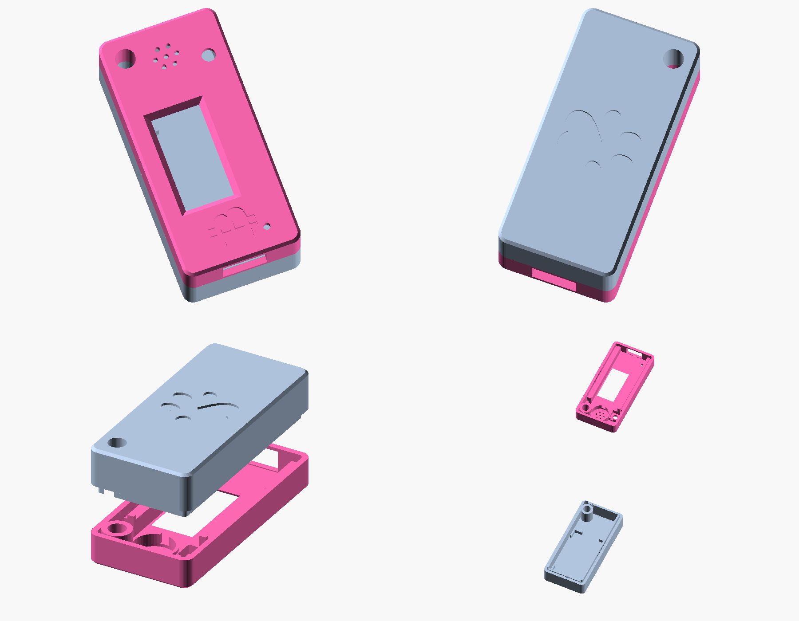

# Satoshi Pet case v2

A parametric rebuild of the v1 Tinkercad case (`../case-v1.stl`), keeping its layout
(screen window, keyring corner, front button, Bitcoin logo, paw on the back) and fixing
what didn't work in v1.



## What changed from v1

| | v1 | v2 |
|---|---|---|
| Closed thickness | ~27 mm | **21.5 mm** |
| Screen window | 15.5 × 26.5 mm straight-walled, 2 mm wall | 13.5 × 25 mm over the OLED's dark area, 1.6 mm wall bevelled 45° |
| Lip fit | 0 mm clearance (lip 29.0 × 66.3 into a 29.0 × 66.2 opening) | 0.2 mm per side (`clr`) |
| Closing | friction only | snap ridges on both long sides (`snap`) |
| USB-C opening | 10 × 4 mm (most cable plugs don't seat) | 9.8 × 4.2 mm around the socket, which reaches to 0.9 mm from the outside |
| Battery | loose in the back cavity | corner ribs hold an 802540 (8 × 25 × 40 mm) |
| Buzzer | glued | ring holder + 7-hole sound grille |
| Button | glued | socket for a 6 × 6 mm tactile switch |
| Board | 0.7 mm pin holes in rails | rails + side guides; end stops under the board's cut-back corners hold it against the USB-C wall (0.2 mm play) |

## Files

| File | What |
|---|---|
| `stl/classic-front.stl`, `stl/classic-back.stl` | Box shape like v1 with small edge chamfers |
| `stl/pebble-front.stl`, `stl/pebble-back.stl` | Same internals, rounded front/back edges and corners |
| `stl/pebble-front-prg-key.stl` | Pebble front with a flexing key over the Heltec's own PRG button instead of a wired button (use with `stl/pebble-back.stl`) |
| `stl/prg-test-A.stl`, `-B`, `-C` | The USB-C end of that front (~12 min each), with the key's nub 0.3 / 0.6 / 0.9 mm above the button. Pick the one that clicks when pressed and not at rest |
| `stl/screen-test.stl` | Front wall + rails only (~10 min). Drop the board in to check screen depth and window position before printing a full case |
| `stl/fit-test.stl` | The USB-C end of both halves (~15 min). Checks the lip/snap fit and the USB-C opening |
| `satoshipet_case.scad`, `artwork.scad` | OpenSCAD source; every dimension is a named parameter at the top |

All parts are already oriented for printing (outside face down, no supports needed).

## Printing

- PLA or PETG, 0.2 mm layers, 3 walls, 15–20 % infill, no supports.
- Print the two test pieces first:
  1. **screen-test**: the board should sit flat on the rails (screen glass just touching the
     front wall) with only the dark screen area showing in the window. If the board rocks on
     the glass, raise `oled_stack` (measured glass height + 0.2 mm). Adjust `win_cx`/`win_cy`
     if the window is off-centre.
  2. **fit-test**: the halves should press together with a click and pull apart by hand.
     Too tight → raise `clr` to 0.25–0.3 or lower `snap`; too loose → lower `clr` to 0.15 or raise `snap` to 0.45.
- Then print the front and back in the style you like.

## Assembly

1. Press the 6 × 6 mm tactile switch into its socket (actuator through the front hole), wire to GPIO 2 + GND.
2. Press the buzzer into its ring (face toward the grille), wires out through the slot toward the board.
3. Drop the board in screen-first; it rests on the rails with the USB-C socket at the opening.
4. Put the battery in the back half between the corner ribs (a thin foam pad on top keeps it from rattling), plug it in.
5. Snap the halves together and thread the keyring through the corner tube.

## PRG key variant (no wired button)


The Heltec already has a PRG button beside its USB-C port, and the firmware
reads it as well as the wired button. In `pebble-front-prg-key.stl` a round pad
is cut free from the front wall on three sides and hangs off a thinned arm; a
nub under it presses PRG. No button to solder or glue. The Bitcoin logo moves
right and shrinks a little to make room, and the v1 pinhole is dropped.

1. Print `prg-test-B` first. Set it over the USB-C end of the board (screen
   side down, USB-C against the end wall) and press the pad.
   - Clicks when pressed, nothing at rest: print `pebble-front-prg-key.stl`.
   - Needs a hard press or doesn't click: try `prg-test-A` (longer nub).
   - Clicks without pressing: try `prg-test-C` (shorter nub).
2. If A or C was the right one, rebuild the front with that clearance:
   `openscad -D 'PART="front"' -D 'STYLE="pebble"' -D 'PRG_KEY=true' -D 'prg_gap=0.3' -o front.stl satoshipet_case.scad`
   (`0.3` for A, `0.9` for C).

Holding PRG while plugging in USB starts the ESP32's flashing mode, so don't
press the key while connecting the cable.

## Changing it

Install [OpenSCAD](https://openscad.org) (free), open `satoshipet_case.scad`, change a parameter,
press F6 then File → Export → STL. Or from a terminal:

```bash
openscad -D 'PART="front"' -D 'STYLE="pebble"' -o front.stl satoshipet_case.scad
```

`PART` is `front`, `back`, `screen_test`, `fit_test`, `prg_test` or `assembly`; `STYLE` is `classic` or `pebble`; `PRG_KEY` is `true` or `false`.
